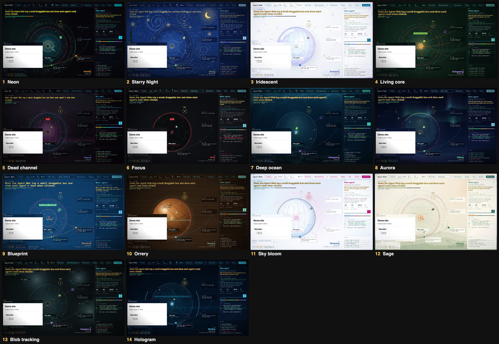

# LiveView

**See what every Claude Code agent is doing, while it does it.**

LiveView is a mod for [Claude Code](https://claude.com/claude-code). It adds a live view of your session: the main agent and every helper it starts, with the file each one is editing, the command it is running, the page it is reading, its plan, and what it costs. Open it beside the chat, in its own full-screen window, or as a small always-on-top monitor in a corner of your screen.



## What you get

- **Live pane** (`/live-view`): a dashboard beside the chat with overview, team, agents, activity and files pages, plus charts of calls, lines changed, tokens and estimated cost over time.
- **Agent team** (`/agent-team`): a wide org chart of every agent at once.
- **Agent Web** (`/agent-web`): every agent as a node in a live web, in its own window. The main agent is a sphere, helpers are hexagons. Edits, reads, searches, runs and errors show as colour-coded activity. Includes replay, a screensaver mode and a full-screen view.
- **Mini monitor** (`/agent-mini`): a small always-on-top window with counts and one tile per agent. Uses a native macOS window when `swiftc` is installed, otherwise a small Chrome window.
- **Each agent's screen**: the file it is editing with the changed lines marked, the terminal it is typing in, or the page it is browsing.
- **Plain-language updates**: "Read 3 files", "Added 12 lines to auth.ts", "3 tests failed".
- **Plan and task cards**: the task each agent was given and the steps from its own to-do list.
- **Site preview**: when an agent starts a local dev server or edits an HTML page, LiveView shows a snapshot of it.
- **Attention alerts**: an agent that needs you, is stuck, is struggling or runs long gets flagged with a shape as well as a colour, and a pop-up for the last three. Keyboard: `A` toggles the agent rail, `/` searches, `N` jumps to whoever needs you.
- **14 styles** (Neon, Starry Night, Iridescent, Living core, Dead channel, Focus, Deep ocean, Aurora, Blueprint, Orrery, Sky bloom, Sage, Blob tracking, Hologram). A style changes how things look, never what they say: colour meanings are the same in all of them (green edit, cyan read, yellow search/goal, amber run, blue web, purple helper, red error).
- **Optional sounds**: a tick on edits, a chime when tests pass or an agent finishes, a buzz on failure. Off by default; turn on with the `sounds` option.

## Install

In Claude Code:

```
/plugin marketplace add prlo74/LiveView
/plugin install live-view@liveview
```

Then run `/live-view`, `/agent-team`, `/agent-web` or `/agent-mini`.

Requirements: Claude Code with mod support. `python3` for the Agent Web and mini monitor. Google Chrome for site snapshots and the Chrome-window fallbacks. macOS is where it is developed and tested.

## Privacy and safety

- Everything runs on your machine. The Agent Web is served from `127.0.0.1` only, to pages from this machine only.
- Secrets are masked before anything is stored or drawn: API keys, tokens, passwords, private keys and `user:password@host` URLs. Files that usually hold secrets (`.env`, `*.pem`, `id_*`, credentials files and similar) show no contents at all.
- Masking is pattern based. A password with no digit in it is not caught, so don't treat it as a guarantee.
- Styles load fonts from Google Fonts. Remove the `fontUrl` line from a style to keep it fully offline.
- Cost figures are estimates from token counts and a built-in price table.

## Make your own style

Each style is one file in `live-view/web/themes/` that calls `registerTheme({...})`. See [`live-view/web/themes/README.md`](live-view/web/themes/README.md) for the full API and the rules (backdrops must move slowly, stay under about 2 ms a frame, and freeze under reduced motion).

To try a change without a Claude session, serve the web folder and open it with demo data:

```
cd live-view/web && python3 -m http.server 8765
# http://localhost:8765/index.html?demo&theme=aurora
```

## Layout

| Path | What it is |
|---|---|
| `live-view/hooks/` | The mod: state, narration, charts, plan, site preview, web server |
| `live-view/web/` | The Agent Web page and its styles |
| `live-view/mini/` | Native mini monitor (Swift) |
| `live-view/tests/` | Tests |
| `docs/` | Screenshots |

## Status

Early (v0.1.0). Issues and pull requests welcome.
